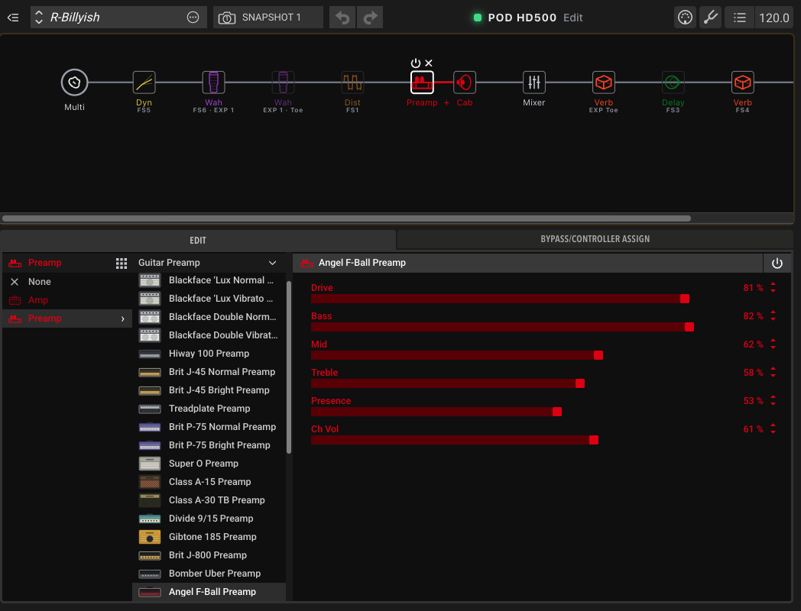
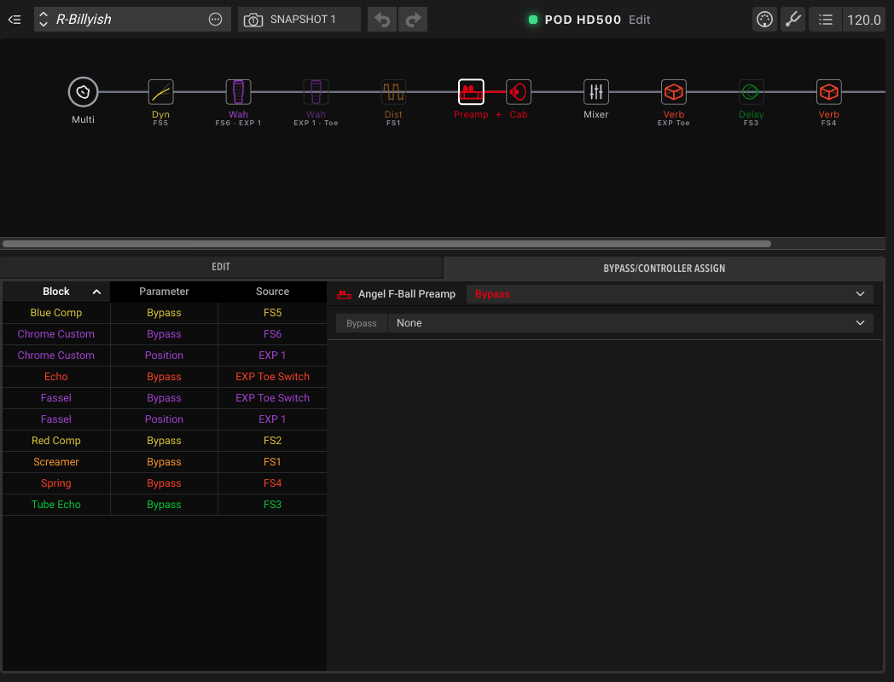
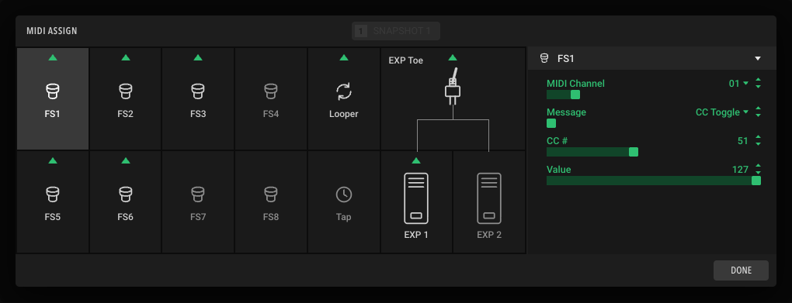
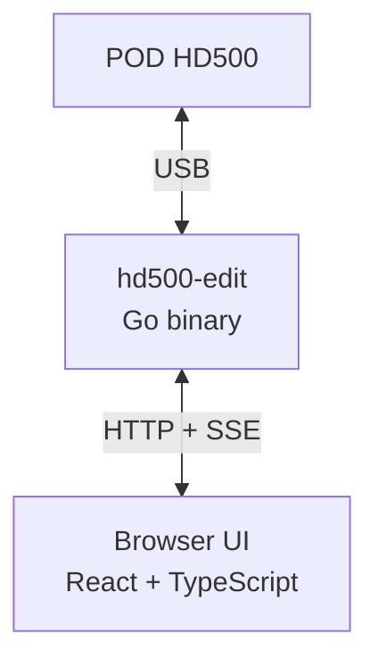
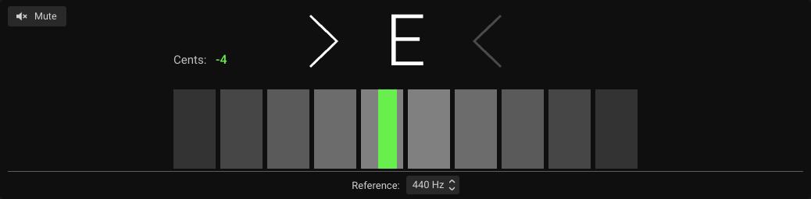

<div align="center">

# podhd500hxedit

**A modern editor for the Line 6 POD HD500, on current macOS.**<br>
HX Edit–style interface · **built-in tuner** · talks to the pedal directly over USB · one Go binary

[](LICENSE)




<sub>The interface, shown with sample data.</sub>

[Features](#features) · [Quick start](#quick-start) · [How it works](#how-it-works) · [Tuner](#a-tuner-the-original-never-had) · [Status](#status-and-limitations) · [API](docs/API.md)

</div>

---

Line 6 no longer maintains the official POD HD500 Edit, and its driver doesn't work on
current macOS / Apple Silicon. This project talks to the pedal directly over USB and runs
as a small local web app: one Go binary that serves the UI on `http://127.0.0.1:8500/`.

> [!WARNING]
> **Work in progress, use at your own risk.** Edits go to the pedal's edit buffer live;
> *Send / Save to Pedal* writes its memory. **Back up your presets first** (the editor's
> Export / Backup). If the pedal stops responding (the connection light turns red), power
> it off and on.

## Features

- **Tuner**: chromatic tuner in the editor, with reference pitch and Mute/Bypass (see [below](#a-tuner-the-original-never-had))
- **Signal flow**: drag blocks, amp positions (Pre / paths / Post), dual amps, on/off,
  footswitch and EXP labels, DSP-limit warnings
- **Every amp, cab and effect** with its parameters, in units that match the pedal's LCD
  (ms, Hz, dB, note sync), checked model by model against the LCD
- **Inputs and Variax** (300/600, 500/700), mixer, tap tempo and Tempo Sync
- **Bypass / Controller Assign**: footswitches, EXP 1/2, Variax knobs, MIDI CCs, MIDI channel
- **MIDI Assign**: what each footswitch and pedal sends on MIDI OUT
- **Setlists and presets**: load, rename, copy/move, send/receive, import/export
  `.h5e` / `.h5s` / `.h5b`, backups
- **An HTTP API** with everything the UI does: see [docs/API.md](docs/API.md)

<table>
  <tr>
    <td width="50%"><br><sub><b>Bypass / Controller Assign</b></sub></td>
    <td width="50%"><br><sub><b>MIDI Assign</b>: the controls laid out as on the pedal's own screen</sub></td>
  </tr>
</table>

## Quick start

**Requirements:** macOS (Apple Silicon or Intel) and a POD HD500 connected by USB. The
Line 6 driver may stay installed for audio.

```sh
scripts/build.sh                # vet, tests and binaries in bin/
sudo ./bin/l6-rebind install    # ONE TIME ONLY (survives reboots and pedal power-ons)
./bin/hd500-edit                # serves http://127.0.0.1:8500/
```

`hd500-edit` opens the page in Google Chrome for Testing (`-open "<app>"` for another
browser, `-open=` for none).

Open `http://127.0.0.1:8500/next/` for the new interface shown above. The classic interface
stays at `/` while the new one is being completed.

**What `install` does.** macOS only lets root detach a kernel driver, so this is the one
step that needs `sudo`, and you run it a single time: the job starts again by itself after every
reboot and every pedal power-on, with no password. It copies `l6-rebind` to `/usr/local/libexec/hd500/`
(root-owned) and registers a small launchd job that checks every 2 seconds and, when a POD HD500
is on USB with the Line 6 driver holding its *control* interface, detaches the driver from that
interface only; audio keeps working. Nothing
else runs as root. Check it first with `./bin/l6-rebind install -n` (prints the plan and the
launchd file, changes nothing); the log is `/var/log/hd500-l6-rebind.log`; remove it with
`sudo /usr/local/libexec/hd500/l6-rebind uninstall`. The editor keeps retrying the connection,
so you can start it before powering the pedal on.

Prefer not to install anything? Run `sudo ./bin/l6-rebind release` after each power-on /
replug instead. Replugging the pedal restores the original driver state.

Set `HD500_DEBUG=1` to log every message the pedal sends (useful to learn new parts of
the protocol).

## How it works



The binary owns the USB link and keeps the pedal's state; the UI only calls the HTTP API
and never talks to the pedal. All the logic lives behind the API, so other clients can use it too.

| Path | What |
|---|---|
| `cmd/hd500-edit` | the editor: HTTP API + embedded web UI (`web/`) |
| `cmd/l6-rebind` | frees the pedal's USB interface from the Line 6 driver |
| `pkg/usb` | USB transport and the pedal's message format |
| `pkg/podhd500` | preset format, model catalog, files |
| `pkg/editor` | session: state, events, edits |
| `frontend/` | the new UI (React + TypeScript + Vite), built into the binary |
| `docs/API.md` | API reference |

## A tuner the original never had

> [!TIP]
> **A tuner built into the editor.** The original POD HD500 Edit has none. Click the tuning
> fork in the header and a full chromatic tuner opens over the signal flow.

<p align="center"></p>

- **Note name and cents**, read from the pedal about five times a second
- **A 10-segment meter** whose marker goes from red to green as you get closer to the note
- **Reference pitch** from 425 to 455 Hz
- **Mute or Bypass** the output while you tune
- Also on the HTTP API (`POST /api/tuner`), see [docs/API.md](docs/API.md)

## Status and limitations

Not available yet, or not possible over USB:

- Undo / Redo
- Snapshots: the HD500 has none, so the Snapshot button is only a placeholder
- Looper position (Pre / Post) and Global EQ: the pedal doesn't expose them over USB

## Acknowledgements

Built with the help of the open work of
[hd500-editor](https://github.com/linepix-idev/hd500-editor), [lpedit-lib](https://github.com/StarAurryon/lpedit-lib),
podhd and the Linux POD HD driver. See [NOTICE](NOTICE) for licenses of included data.

## License

MIT, see [LICENSE](LICENSE). Some data files carry their own licenses: see [NOTICE](NOTICE).

Line 6, POD and HX Edit are trademarks of Yamaha Guitar Group, Inc. This project is
not affiliated with or endorsed by Line 6.
